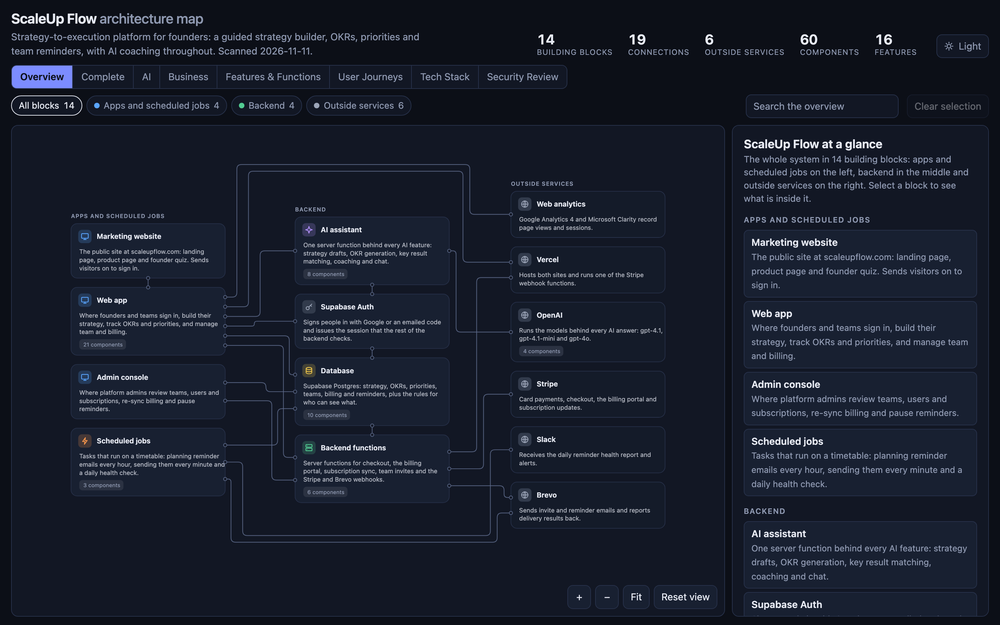
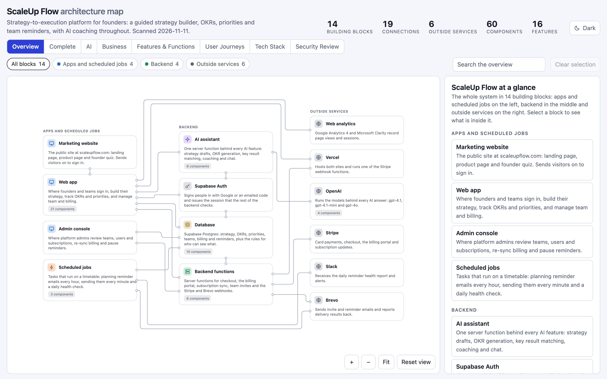
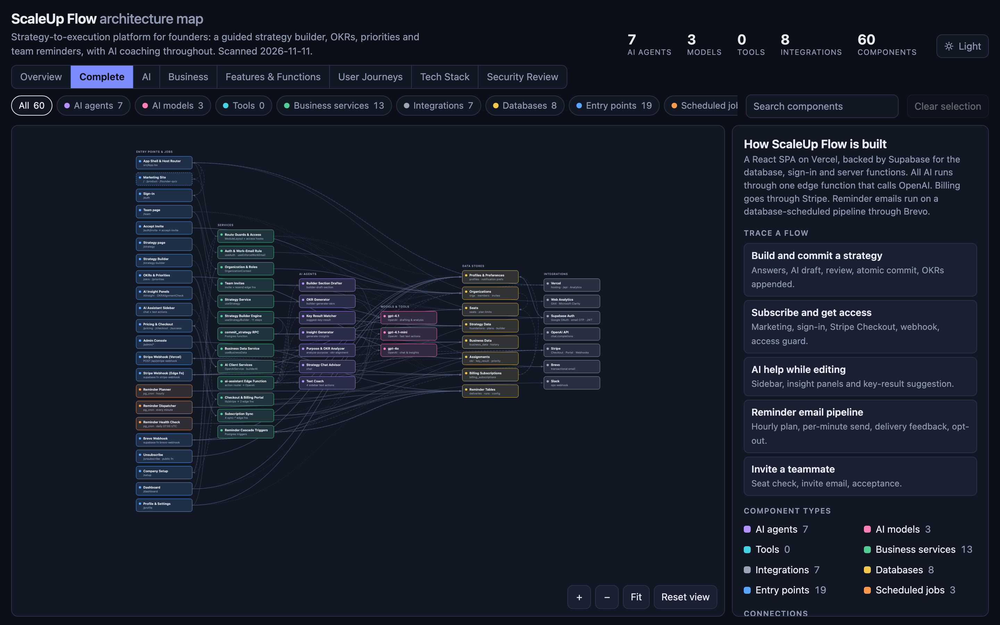
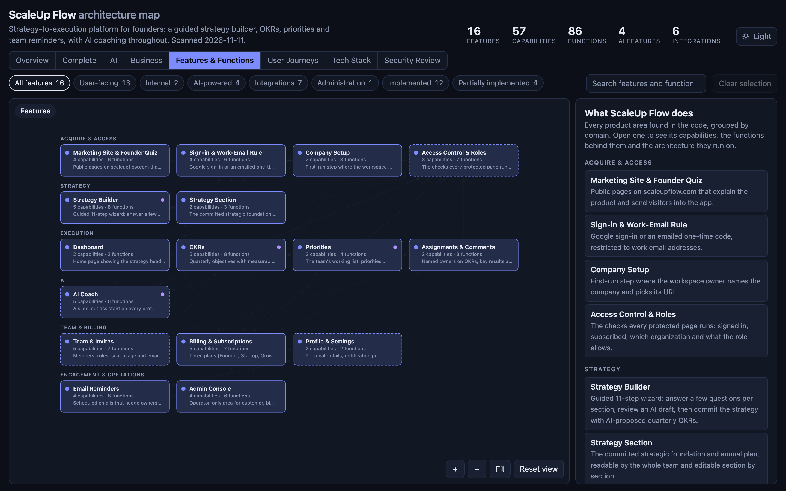
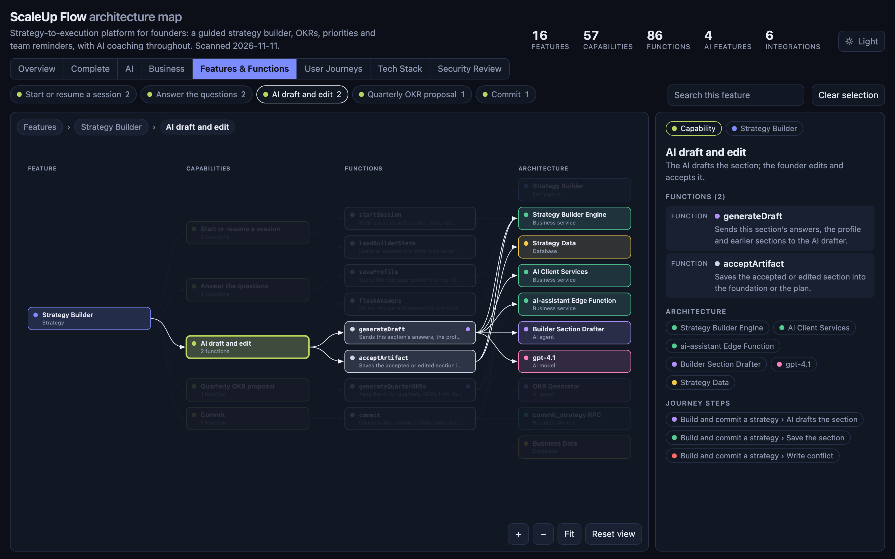
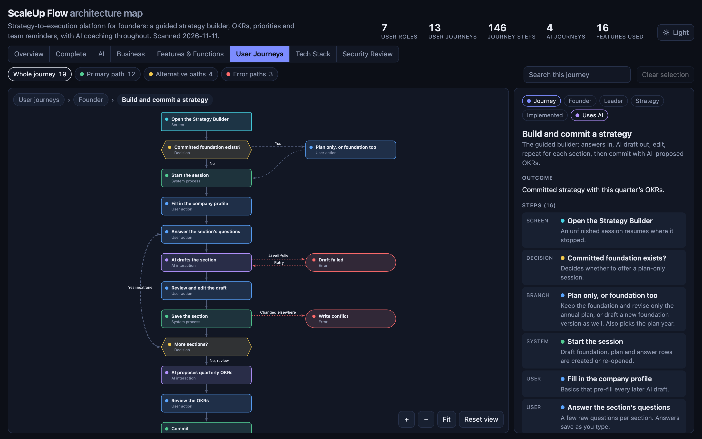
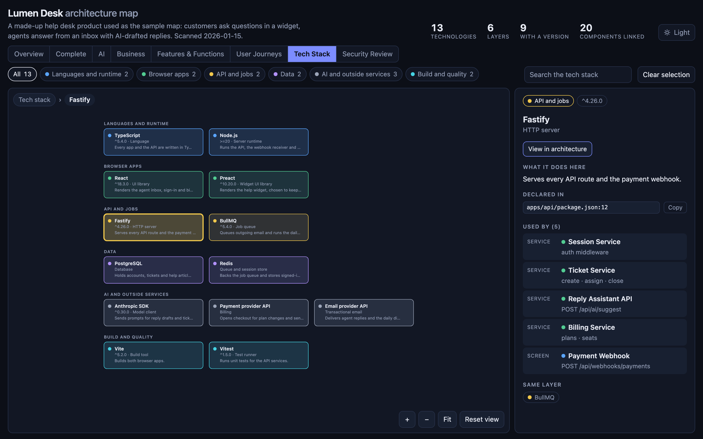
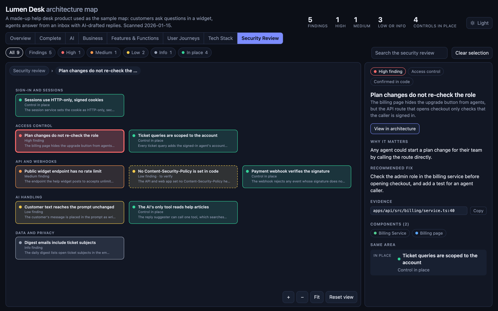
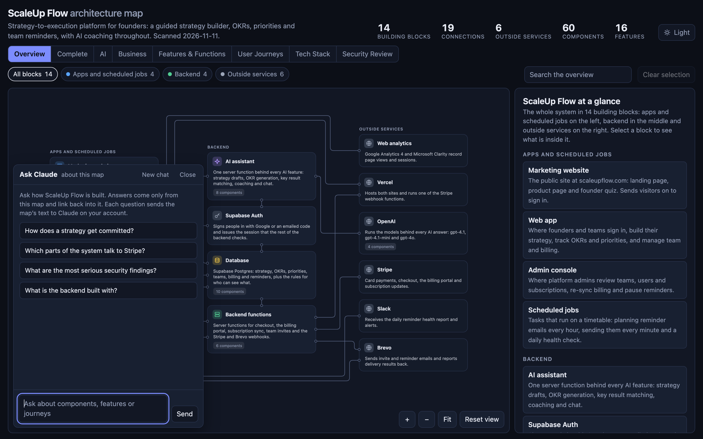

# Architecture Explorer

A Claude plugin that reads a code repository without changing it and builds one interactive page explaining the system.

The page has eight linked views and a chat:

| View | Shows |
|---|---|
| Overview | The system as a few large blocks and the lines between them |
| Complete | Every component and relationship, with what each does, why it exists and where it is in the code |
| AI | Agents, models and tools only (hidden when a system has no AI) |
| Business | Everything except the AI machinery |
| Features & Functions | What the product does, down to the function and file behind each capability |
| User Journeys | How each kind of user gets something done, step by step, with decision and error branches |
| Tech Stack | Every technology the system is built with, grouped by layer, with its declared version, what it does here and the components that use it |
| Security Review | Controls that are in place and findings by level, each with the evidence in code, why it matters and a recommended fix |
| Ask Claude | A chat that answers from the map and links its answers back into the views |

The result is published as a private Claude Artifact, or left as a single local HTML file where publishing is not available.

## Screenshots

These are from a map of ScaleUp Flow, a NEXLOR product.

**Overview**: the system as a few large blocks.



**Light and dark**: the page follows the viewer's Claude theme or system setting, and the button at the top right switches between the two.



**Complete**: every component and relationship.



**Features & Functions**: what the product does, then one capability traced down to its functions and the architecture behind them.





**User Journeys**: one journey with its decision and error branches.



**Tech Stack** and **Security Review**: shown here on Lumen Desk, the made-up sample map that ships with the plugin. A real security review belongs to the system's owner and stays in their private map.





**Ask Claude**: the chat panel with its starter questions.



## Using it

Say what you want in plain words:

- "Get started with the architecture explorer" for a guided first run with a sample map.
- "Map the architecture of this repo" to scan and publish.
- "Update the architecture map" to rescan what changed and republish to the same link.
- "Check the explorer tools" to confirm everything works on this machine.
- "Change how the architecture map looks" to change the shared template.

## What is in the plugin

| Part | Purpose |
|---|---|
| `skills/map-architecture` | The scan, build, check and publish workflow, with the safety rules, the scan method and the data model |
| `skills/explorer-setup` | Tool setup: checks the machine and explains what is and is not available |
| `skills/explorer-onboarding` | A guided first run for a new user |
| `skills/explorer-design-system` | How to change the template without breaking the system |
| `design-system/` | The design system (`DESIGN.md`) and its tokens (`tokens.json`) |
| `template/explorer.html` | The page every map is built from |
| `scripts/` | `doctor`, `validate`, `build`, `smoke`, `snapshot`, `extract` |
| `examples/lumen-desk/` | A complete sample map of a made-up product |
| `ONBOARDING.md` | A one-page guide to hand to a teammate |

## Requirements

- Node.js 18 or newer. No packages are installed; the scripts use only what ships with Node.
- Optional: macOS, for rendering still pictures as PNG. Elsewhere the scripts write SVG files that open in any browser.
- For a shareable link: a Claude app with the Artifact tool. For the chat: a viewer whose Claude plan allows artifacts to ask Claude.

## Safety

The scan is read-only. It never runs the repository's code, installs anything, runs migrations, reads `.env` files or secrets, or sends repository content to outside services. The map data is checked for keys, tokens, price ids and email addresses before it is built. Working files are kept outside the repository. The full rules are in `skills/map-architecture/references/scan-rules.md`.

The Ask Claude chat sends the map's text and the viewer's question to Claude on the viewer's own account. Nothing else leaves the page.

## Limits

- The security review is a static, read-only read of the code made while mapping it. It is not a penetration test, it runs no vulnerability scan, and it cannot see settings held outside the repository.

- A map holds at most 60 components and 120 relationships; larger systems are grouped.
- The map is a reading of the code at one point in time. Anything marked inferred or documented was not traced.
- Layout is checked from still pictures and a scripted run, not in a live browser. The chat is tested with a stand-in for Claude; a real answer is only seen on the published page.
- Pages built before this plugin hold their data as code and cannot be updated in place; rescan instead.

## Running the tools by hand

```bash
node scripts/doctor.cjs
node scripts/validate.cjs examples/lumen-desk/architecture.json
node scripts/build.cjs examples/lumen-desk/architecture.json /tmp/lumen-desk.html
node scripts/smoke.cjs /tmp/lumen-desk.html
node scripts/snapshot.cjs /tmp/lumen-desk.html /tmp/lumen-desk-shots --png
node scripts/extract.cjs /tmp/lumen-desk.html /tmp/lumen-desk.json
```

## Licence

MIT. See [LICENSE](LICENSE).
